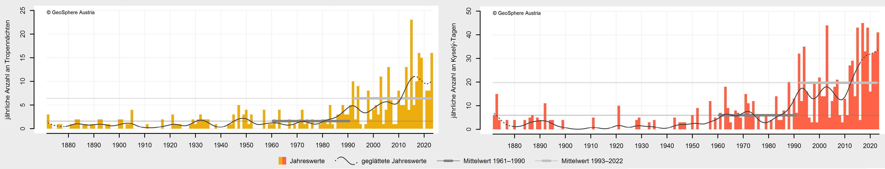
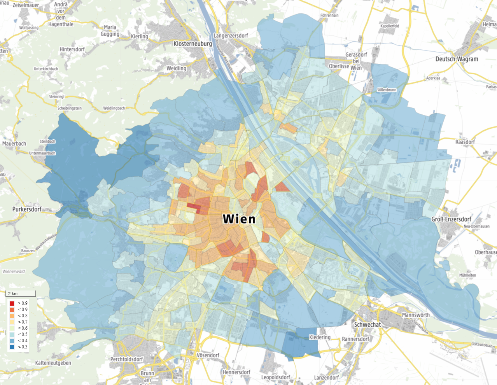
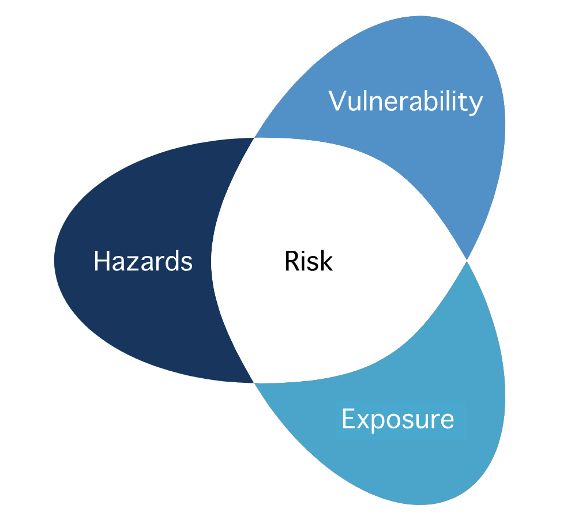
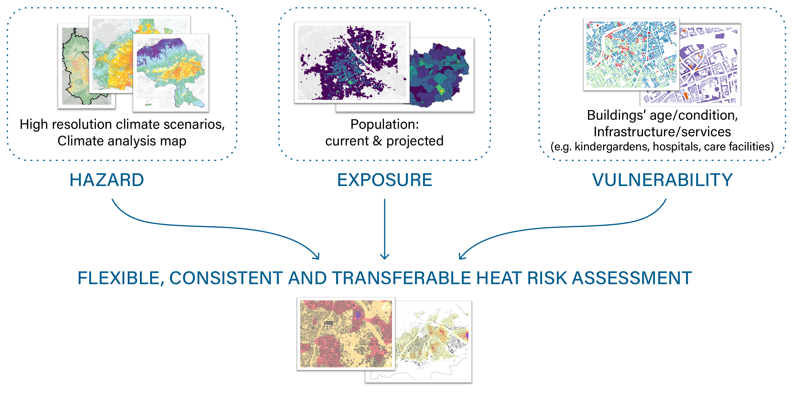

# Heat Risk Maps <!--{ as="img" mode="hero" src="https://raw.githubusercontent.com/GTIF-Austria/public-narratives/47353ce63d973d085fa7a878d51f386434b198e5/assets/aakozlowska/heat-risk-map-2-1795018103478.png" }-->

## The Challenge
Extreme heat during the day and no cooling at night:
In Vienna, the number of heat days and tropical nights is rising steadily.

<em>Source: Klimastatusbericht Österreich 2023, Klimarückblick Wien, ed. CCCA 2024.</em>

In **2024**, the **Hohe Warte station in Vienna** recorded  
›	twice as many summer days,  
›	more than four times as many heat days, and     
›	more than ten times as many tropical nights     
as in the 1961 - 1990 reference period.

<em>Source: <a href="https://klimadashboard.at/en">www.klimadashboard.at</a></em>

**High population density** and the **urban heat island effect** force cities to adapt and take action against this growing threat.
**Vulnerable groups** in particular suffer from persistently high temperatures and heat stress, with serious consequences for their health.    
**Yet adaptation measures are often only effective locally, and resources are limited**.

This raises a number of **pressing questions**, including:  
›	Where are measures to reduce heat stress needed?    
›	Which population groups should be better protected/supported through targeted measures?   
›	Where is action most urgently needed?   
›	Which areas should be prioritised?  

In recent years, **various studies analysing the urban climate and heat exposure** have been carried out. Examples include the **Vienna Urban Climate Analysis (Stadtklimaanalyse Wien, 2020)** and the **Urban Heat Vulnerability Index (UHVI) Vienna (2019)**.

<em>Source: <a href="https://www.wien.gv.at/stadtplanung/stadtklimaanalyse">Stadtklimaanalyse Wien 2020</a> (City of Vienna - Urban Development and Planning, Weatherpark GmbH, INKEK GmbH)</em>

<em>Source: Illustration by orf.at based on data from the City of Vienna (energie.wien.gv.at), ECOTEN, OpenStreetMap</em>

### Where is there room for improvement in providing usable data and information?

#### 1. Flexibility & Timeliness
##### Heat ≠ Heat Risk
While some people happily sit in the sun at 30°C, for others this already poses a health risk.
**One-off, static maps** provide a solid basis, but can raise **further questions and call for additional analyses** that are not immediately available. **Updates** due to changed conditions (land use & development, population structure, etc.) or a variable spatial resolution are not possible.

#### 2. Consistency
Due to the **use of different input data, calculation methods or objectives**, related studies can show inconsistencies (in the degree of heat stress, the need for action, etc.) and lead to problems in decision-making and communication.

#### 3. Transferability
Detailed analyses usually require **tailor-made solutions for individual cities**. So far, there is no standardised method for calculating heat risk that would make it available for many cities and regions. 

## Our Solution

<strong>Flexible, consistent and transferable heat risk maps</strong> support not only <strong>cities and municipalities</strong>, but also <strong>companies and organisations</strong> that need to assess future heat risks.

In line with the IPCC risk concept (Sixth Assessment Report (AR6), Working Group II), <strong>risk is composed of hazard, exposure and vulnerability</strong>.

A **sound risk assessment** makes it possible to shape future developments, make effective investments and **place measures where they are needed**.
This requires comprehensively compiling and linking data from different disciplines. 

Our heat risk algorithm combines **current satellite information**, such as building structure, degree of soil sealing or tree cover, with **population statistics** and high-resolution **climate data** tailored to Austria. 

The hazard layer describes how often nights stay warm. It is based on the number of **tropical nights per year** (minimum temperature of at least 20 °C). Climate projections for Austria were downscaled to the city scale using the climate analysis map of the Vienna Urban Climate Analysis, which shows how buildings, sealed surfaces and green spaces influence local night-time cooling. The result is a series of high-resolution heat maps for Vienna from **2020 to 2090** in ten-year steps.

The exposure layer shows **who lives where**. Current population data from **Statistik Austria** were combined with the **ÖROK population projections up to 2050** and broken down into five age groups (0–19, 20–44, 45–64, 65–84 and 85+ years). This makes it possible to analyse not only where heat occurs, but also which population groups are affected, today and in the future.

The methodology allows the heat risk maps to be recalculated whenever new or updated datasets become available, making the **effects of adaptation measures and urban development visible**.

It also makes it possible to include **future spatial planning scenarios or demographic developments** and to anticipate future impacts. While open-source data form the basis, available city-specific data can enable higher quality.
The heat risk maps thus make it possible to determine the **spatial distribution of heat risk** for a **defined population group, infrastructure, etc.** under **selected climatic conditions**.  

**Examples: selection of possible heat hazards**:   
›	Daily maximum air temperature > 25°C / 30°C / 35°C / 40°C   
›	Daily minimum air temperature > 20°C    
›	X consecutive days with a daily maximum air temperature > Y°C   
›	under current or future climate conditions  
›	... other climate indices   

**Examples: definition of vulnerable groups**:  
›	Children and younger people (e.g. 0-19 years)   
›	Older people (e.g. 65+ years)    
›	Locations of vulnerable social infrastructure (kindergartens, hospitals, care homes, etc.)      
›	People on low incomes   
›	Consideration of existing cool spots or similar places to cool down     
›	... other factors that increase/reduce vulnerability    

## Use Cases
Thanks to the flexible choice of data, heat risk can be calculated for a wide range of use cases, including:   
•	**Heat action and heat protection plans**: Integrating heat risk maps can help tailor measures to the areas at risk.   
•	**Urban development concepts**: Heat risk maps provide valuable information for spatial planning and urban development, helping cities remain liveable in the future.   
•	**Prioritising adaptation measures**: Comparing areas within cities and regions.    
•	**Updating current heat risk information**: Changing climate conditions, the development of urban areas and changing population statistics render outdated maps unusable. The algorithm allows straightforward updates.   
•	**Identifying locations with future risks**: Organisations and companies working with vulnerable groups can identify places with high or low, current and future heat risk, which is crucial for planning locations and operations.   

## Available services
1. **Free version:** During project runtime, example forecasts are available for chosen part of Vienna. Long term strategy T.B.D.
2. **Commercial version:** upon request, please contact [Jan Peters-Anders](mailto:jan.peters-anders@ait.ac.at)

## Example Maps <!--{ as="eox-map" mode="tour" }-->

### <!--{ layers='[{"type":"Tile","properties":{"id":"satellite","title":"EOxCloudless 2025"},"source":{"type":"XYZ","url":"https://{a-e}.s2maps-tiles.eu/wmts/1.0.0/s2cloudless-2025_3857/default/g/{z}/{y}/{x}.jpeg","attributions":"Sentinel-2 cloudless - s2maps.eu by EOX IT Services GmbH (Contains modified Copernicus Sentinel data 2025)"}},{"type":"WebGLTile","properties":{"id":"heat_step1","title":"Heat exposure 2090, ages 45-64, population 2050"},"source":{"type":"GeoTIFF","normalize":false,"interpolate":false,"sources":[{"url":"https://workspace-ui-public.gtif-austria.hub-otc.eox.at/api/public/share/public-4wazei3y-02/heatrisk/Heatexposure_Vienna_blurred/heatrisk_hazard_2090_multiband.tif"}]},"style":{"color":["case",["==",["band",12],2],"rgba(251,255,200,0.8)",["==",["band",12],3],"rgba(254,221,144,0.8)",["==",["band",12],4],"rgba(244,114,119,0.8)",["==",["band",12],5],"rgba(147,60,220,0.8)","rgba(255,255,255,0)"]}}]' center=[16.37349215538594,48.208361321627784] zoom="11" animationOptions="{duration:500}" }-->

#### Age-specific heat exposure maps
Who is exposed to heat, and where? These maps combine projected tropical nights (nights with a minimum temperature of at least 20 °C) with the spatial distribution of Vienna’s population by age group. Exposure levels range from low to very strong and can be shown separately for five age groups (0–19, 20–44, 45–64, 65–84 and 85+ years). On the following maps, we follow one area of the city through time to show how the result depends on the climate period, the population year and the age group.

### <!--{ layers='[{"type":"Tile","properties":{"id":"satellite","title":"EOxCloudless 2025"},"source":{"type":"XYZ","url":"https://{a-e}.s2maps-tiles.eu/wmts/1.0.0/s2cloudless-2025_3857/default/g/{z}/{y}/{x}.jpeg","attributions":"Sentinel-2 cloudless - s2maps.eu by EOX IT Services GmbH (Contains modified Copernicus Sentinel data 2025)"}},{"type":"WebGLTile","properties":{"id":"heat_step1","title":"Heat exposure 2090, ages 45-64, population 2050"},"source":{"type":"GeoTIFF","normalize":false,"interpolate":false,"sources":[{"url":"https://workspace-ui-public.gtif-austria.hub-otc.eox.at/api/public/share/public-4wazei3y-02/heatrisk/Heatexposure_Vienna_blurred/heatrisk_hazard_2090_multiband.tif"}]},"style":{"color":["case",["==",["band",12],2],"rgba(251,255,200,0.8)",["==",["band",12],3],"rgba(254,221,144,0.8)",["==",["band",12],4],"rgba(244,114,119,0.8)",["==",["band",12],5],"rgba(147,60,220,0.8)","rgba(255,255,255,0)"]}}]' center=[16.37349215538594,48.208361321627784] zoom="11" animationOptions="{duration:500}" }-->

#### Exposure Levels
<table style="width: 100%; border-collapse: collapse;">
<thead>
<tr style="border-bottom: 2px solid #999;">
<th style="padding: 6px; text-align: left; font-size: 0.75em;">Exposure Level</th>
<th style="padding: 6px; text-align: left; font-size: 0.75em;">Interpretation of the potential risk</th>
</tr>
</thead>
<tbody>
<tr style="border-bottom: 1px solid #ddd;">
<td style="padding: 6px; font-size: 0.75em; background-color: rgb(251,255,200); color: #000;"><strong>Low</strong></td>
<td style="padding: 6px; font-size: 0.75em;">Warm nights in most summers; indicates increasing frequency of short heat waves</td>
</tr>
<tr style="border-bottom: 1px solid #ddd;">
<td style="padding: 6px; font-size: 0.75em; background-color: rgb(254,221,144); color: #000;"><strong>Medium</strong></td>
<td style="padding: 6px; font-size: 0.75em;">Warm nights every year; persistent heat wave risk and increasing chronic heat exposure</td>
</tr>
<tr style="border-bottom: 1px solid #ddd;">
<td style="padding: 6px; font-size: 0.75em; background-color: rgb(244,114,119); color: #000;"><strong>Strong</strong></td>

<td style="padding: 6px; font-size: 0.75em;">Warm nights dominate summer; heat waves expected annually; burden on health and emergency services</td>
</tr>
<tr style="border-bottom: 1px solid #ddd;">
<td style="padding: 6px; font-size: 0.75em; background-color: rgb(147,60,220); color: #fff;"><strong>Very strong</strong></td>
<td style="padding: 6px; font-size: 0.75em;">Warm nights dominate summer; intense, prolonged heat waves; severe burden on health and emergency services</td>
</tr>
</tbody>
</table>

### <!--{ layers='[{"type":"Tile","properties":{"id":"satellite","title":"EOxCloudless 2025"},"source":{"type":"XYZ","url":"https://{a-e}.s2maps-tiles.eu/wmts/1.0.0/s2cloudless-2025_3857/default/g/{z}/{y}/{x}.jpeg","attributions":"Sentinel-2 cloudless - s2maps.eu by EOX IT Services GmbH (Contains modified Copernicus Sentinel data 2025)"}},{"type":"WebGLTile","properties":{"id":"heat_step4","title":"Zoom: heat exposure 2020, ages 0-19, population 2025"},"source":{"type":"GeoTIFF","normalize":false,"interpolate":false,"sources":[{"url":"https://workspace-ui-public.gtif-austria.hub-otc.eox.at/api/public/share/public-4wazei3y-02/heatrisk/Heatexposure_Vienna_blurred/heatrisk_hazard_2020_multiband.tif"}]},"style":{"color":["case",["==",["band",1],2],"rgba(251,255,200,0.8)",["==",["band",1],3],"rgba(254,221,144,0.8)",["==",["band",1],4],"rgba(244,114,119,0.8)",["==",["band",1],5],"rgba(147,60,220,0.8)","rgba(255,255,255,0)"]}},{"type":"Vector","properties":{"id":"shape_step4","title":"High-resolution test area"},"source":{"type":"Vector","url":"https://workspace-ui-public.gtif-austria.hub-otc.eox.at/api/public/share/public-4wazei3y-02/heatrisk/non_blurred_shape.geojson","format":{"type":"GeoJSON","dataProjection":"EPSG:4326"}},"style":{"fill-color":"rgba(0,0,0,0)","stroke-color":"#00B050","stroke-width":5,"stroke-line-cap":"round","stroke-line-join":"round"}}]' center=[16.372125918114133,48.173026657980216] zoom="14.0" animationOptions="{duration:500}" }-->
 
#### Today: children and young people
We start with the present: the climate of 2020 combined with the current population aged 0–19. This is the baseline for the following steps.

### <!--{ layers='[{"type":"Tile","properties":{"id":"satellite","title":"EOxCloudless 2025"},"source":{"type":"XYZ","url":"https://{a-e}.s2maps-tiles.eu/wmts/1.0.0/s2cloudless-2025_3857/default/g/{z}/{y}/{x}.jpeg","attributions":"Sentinel-2 cloudless - s2maps.eu by EOX IT Services GmbH (Contains modified Copernicus Sentinel data 2025)"}},{"type":"WebGLTile","properties":{"id":"heat_step5","title":"Zoom: heat exposure 2050, ages 0-19, population 2050"},"source":{"type":"GeoTIFF","normalize":false,"interpolate":false,"sources":[{"url":"https://workspace-ui-public.gtif-austria.hub-otc.eox.at/api/public/share/public-4wazei3y-02/heatrisk/Heatexposure_Vienna_blurred/heatrisk_hazard_2050_multiband.tif"}]},"style":{"color":["case",["==",["band",4],2],"rgba(251,255,200,0.8)",["==",["band",4],3],"rgba(254,221,144,0.8)",["==",["band",4],4],"rgba(244,114,119,0.8)",["==",["band",4],5],"rgba(147,60,220,0.8)","rgba(255,255,255,0)"]}},{"type":"Vector","properties":{"id":"shape_step5","title":"High-resolution test area"},"source":{"type":"Vector","url":"https://workspace-ui-public.gtif-austria.hub-otc.eox.at/api/public/share/public-4wazei3y-02/heatrisk/non_blurred_shape.geojson","format":{"type":"GeoJSON","dataProjection":"EPSG:4326"}},"style":{"fill-color":"rgba(0,0,0,0)","stroke-color":"#00B050","stroke-width":5,"stroke-line-cap":"round","stroke-line-join":"round"}}]' center=[16.372125918114133,48.173026657980216] zoom="14.0" animationOptions="{duration:500}" }-->
 
#### Mid-century: more tropical nights
In 2050, both the climate and the population have changed. With more tropical nights and a growing young population in some parts of the city, the exposure pattern for 0–19-year-olds shifts.
 
### <!--{ layers='[{"type":"Tile","properties":{"id":"satellite","title":"EOxCloudless 2025"},"source":{"type":"XYZ","url":"https://{a-e}.s2maps-tiles.eu/wmts/1.0.0/s2cloudless-2025_3857/default/g/{z}/{y}/{x}.jpeg","attributions":"Sentinel-2 cloudless - s2maps.eu by EOX IT Services GmbH (Contains modified Copernicus Sentinel data 2025)"}},{"type":"WebGLTile","properties":{"id":"heat_step6","title":"Zoom: heat exposure 2090, ages 0-19, population 2050"},"source":{"type":"GeoTIFF","normalize":false,"interpolate":false,"sources":[{"url":"https://workspace-ui-public.gtif-austria.hub-otc.eox.at/api/public/share/public-4wazei3y-02/heatrisk/Heatexposure_Vienna_blurred/heatrisk_hazard_2090_multiband.tif"}]},"style":{"color":["case",["==",["band",4],2],"rgba(251,255,200,0.8)",["==",["band",4],3],"rgba(254,221,144,0.8)",["==",["band",4],4],"rgba(244,114,119,0.8)",["==",["band",4],5],"rgba(147,60,220,0.8)","rgba(255,255,255,0)"]}},{"type":"Vector","properties":{"id":"shape_step6","title":"High-resolution test area"},"source":{"type":"Vector","url":"https://workspace-ui-public.gtif-austria.hub-otc.eox.at/api/public/share/public-4wazei3y-02/heatrisk/non_blurred_shape.geojson","format":{"type":"GeoJSON","dataProjection":"EPSG:4326"}},"style":{"fill-color":"rgba(0,0,0,0)","stroke-color":"#00B050","stroke-width":5,"stroke-line-cap":"round","stroke-line-join":"round"}}]' center=[16.372125918114133,48.173026657980216] zoom="14.0" animationOptions="{duration:500}" }-->
 
#### End of the century: further warming
By 2090, tropical nights become even more frequent. For citizens, this means that heat exposure increases further, and areas that were moderately affected around mid-century will reach higher exposure levels. Here, we look at the results for population group 0-19 years old.
 
### <!--{ layers='[{"type":"Tile","properties":{"id":"satellite","title":"EOxCloudless 2025"},"source":{"type":"XYZ","url":"https://{a-e}.s2maps-tiles.eu/wmts/1.0.0/s2cloudless-2025_3857/default/g/{z}/{y}/{x}.jpeg","attributions":"Sentinel-2 cloudless - s2maps.eu by EOX IT Services GmbH (Contains modified Copernicus Sentinel data 2025)"}},{"type":"WebGLTile","properties":{"id":"heat_step7","title":"Zoom: heat exposure 2090, ages 65-84, population 2050"},"source":{"type":"GeoTIFF","normalize":false,"interpolate":false,"sources":[{"url":"https://workspace-ui-public.gtif-austria.hub-otc.eox.at/api/public/share/public-4wazei3y-02/heatrisk/Heatexposure_Vienna_blurred/heatrisk_hazard_2090_multiband.tif"}]},"style":{"color":["case",["==",["band",16],2],"rgba(251,255,200,0.8)",["==",["band",16],3],"rgba(254,221,144,0.8)",["==",["band",16],4],"rgba(244,114,119,0.8)",["==",["band",16],5],"rgba(147,60,220,0.8)","rgba(255,255,255,0)"]}},{"type":"Vector","properties":{"id":"shape_step7","title":"High-resolution test area"},"source":{"type":"Vector","url":"https://workspace-ui-public.gtif-austria.hub-otc.eox.at/api/public/share/public-4wazei3y-02/heatrisk/non_blurred_shape.geojson","format":{"type":"GeoJSON","dataProjection":"EPSG:4326"}},"style":{"fill-color":"rgba(0,0,0,0)","stroke-color":"#00B050","stroke-width":5,"stroke-line-cap":"round","stroke-line-join":"round"}}]' center=[16.372125918114133,48.173026657980216] zoom="14.0" animationOptions="{duration:500}" }-->
 
#### Same climate, different age group
The climate stays the same, but we now look at people aged 65–84. The pattern looks different, because older people live in different parts of the city than children and young people. Heat risk therefore depends not only on where it gets hot, but also on who lives there.

This is just one example. The maps shown here are displayed at a reduced level of detail. To explore other climate periods, population years and age groups, visit the [GTIF Austria data explorer](https://gtif-austria.info/explore?indicator=heatrisk_vienna&x=16.3659&y=48.1752&z=12.6272&datetime=2090-01-01&template=expert). 

## Contact
**Jan Peters-Anders** 
jan.peters-anders@ait.ac.at 
Research Engineer 
Digital Resilient Cities 
Center for Energy

**AIT Austrian Institute of Technology GmbH** 
<a href="www.ait.ac.at">www.ait.ac.at</a> 

