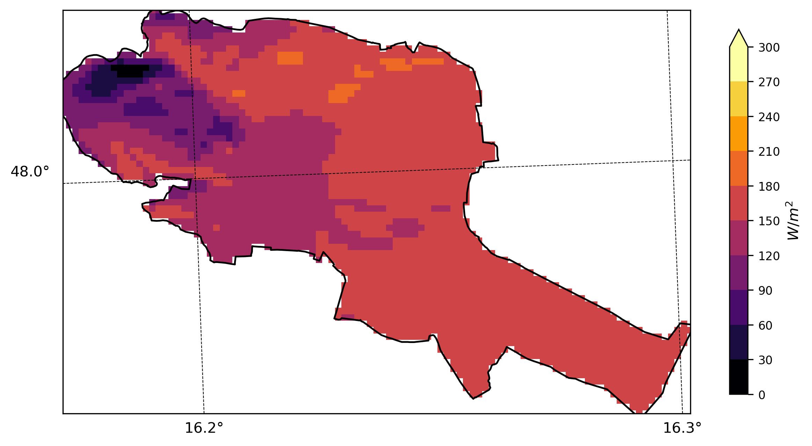
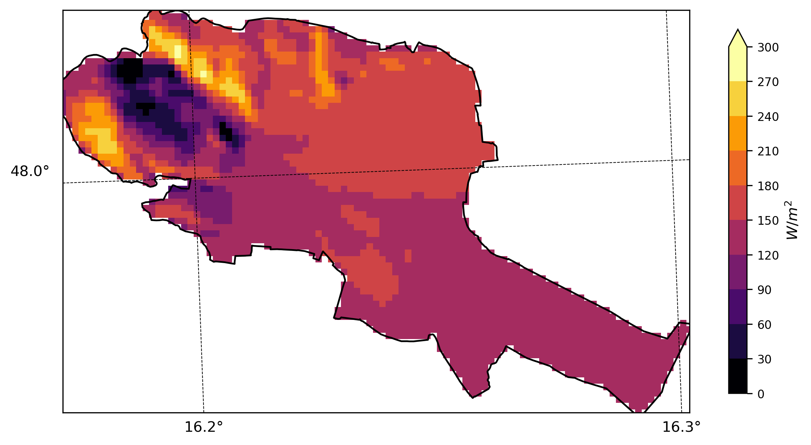
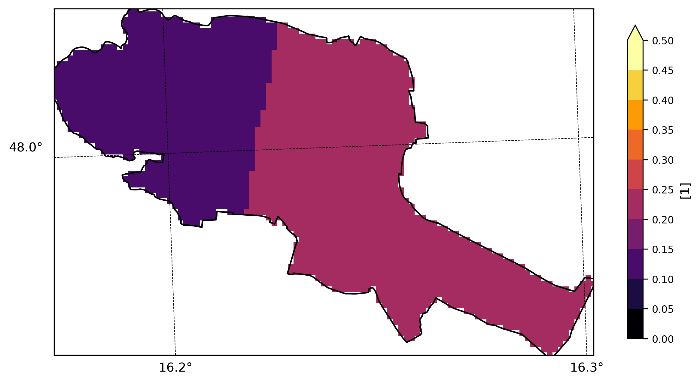
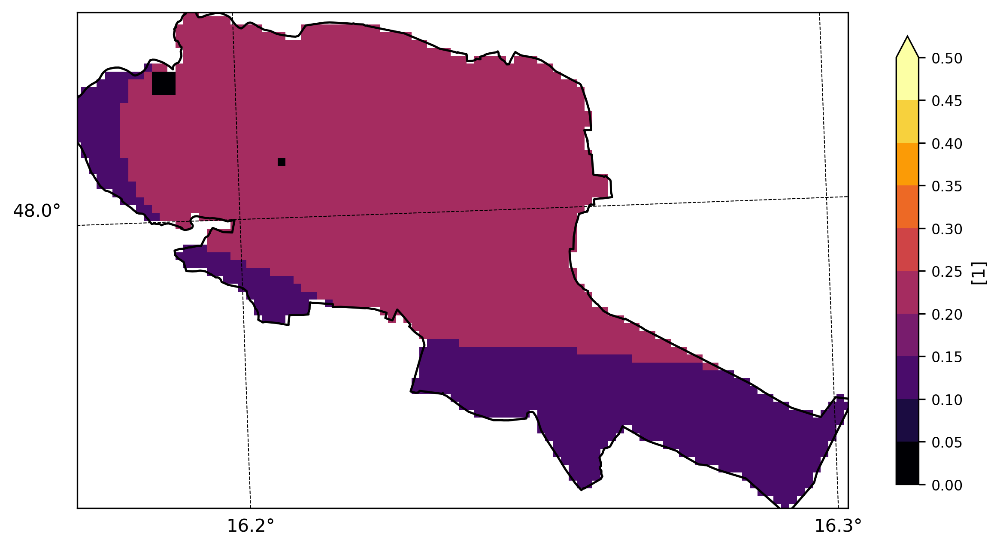
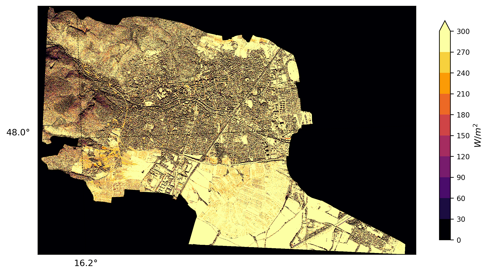
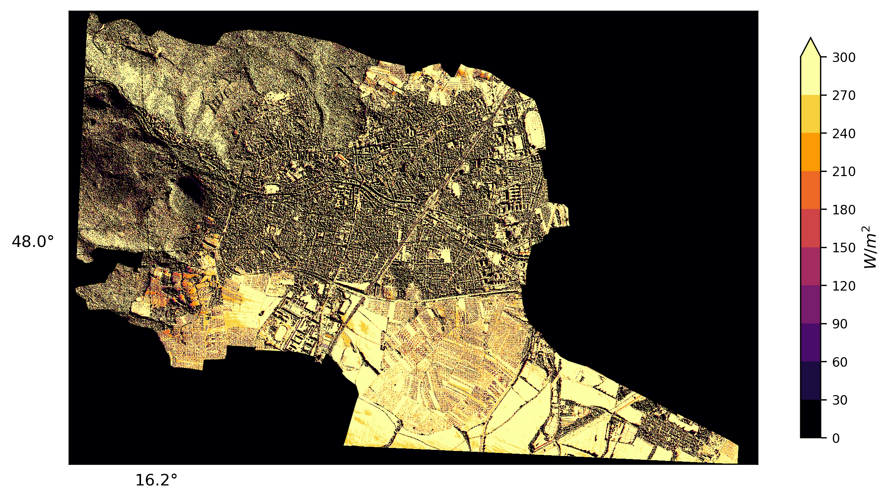
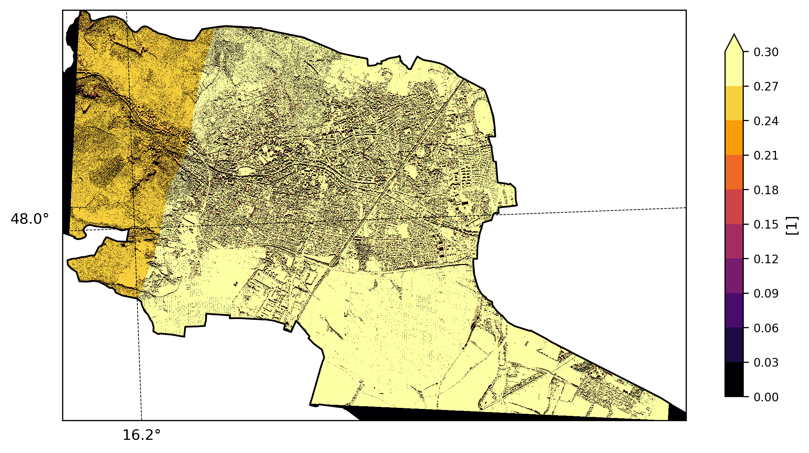
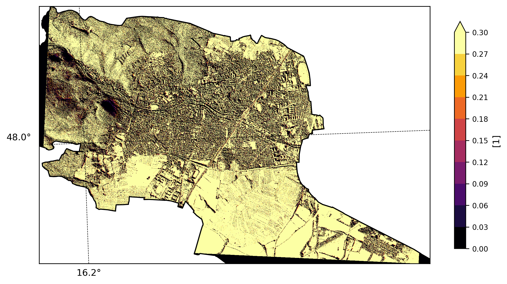

# High-resolution Forecasts of Solar Potential <!--{ as="img" mode="hero" src="https://raw.githubusercontent.com/triebnigg/public-narratives/triebnigg/evapotranspiration-monitoring-2/assets/triebnigg/solar-potential-1749907032353.webp"}-->

Every location tells a different story when it comes to solar energy. The amount of sunlight reaching a surface is shaped not only by weather, but also by terrain, surrounding features and local environmental conditions. By combining high-resolution geospatial and meteorological data with physical modelling, this service brings these elements together to uncover the solar radiation and photovoltaic potential of any given area. The result is a detailed spatial and temporal perspective on where solar energy potential lies and how it changes over time.

## About the service

This service combines meteorological data, high-resolution geospatial information and physical modelling approaches. On this basis, near-surface solar radiation and theoretical photovoltaic generation potential are calculated and represented in a spatially and temporally differentiated way.

##### What influences the solar energy potential?

🌅 <strong>Sun and Weather</strong>
  <ul>
    ☀️ solar radiation 
    ☁️ cloud cover 
    🌡️ temperature 
    🌬️️️  wind 
    💨 ️dust cover 
    ❄️ snow cover
  </ul>

🌅 <strong>Geographic Conditons</strong>
  <ul>
    🏔️ topography 
    🧭 terrain orientation 
    🌥️ shading 
    🏢 buildings 
    🌳 vegetation
  </ul>

##### What does the service deliver? 

The processing chain brings together solar radiation calculations, spatial refinement and photovoltaic modelling. Additional modules can be used to incorporate estimates of dust- and snow-related effects.

    <h5> ☀️ ️Radiation Information</h5>
    
 Radiation modelling is done with the STRAHLGRID model   --> caluclation of direct, diffuse and global radiation   --> <strong>100x100m</strong> spatial resolution
    
 Downscaling to <strong>1x1m</strong> can be performed to include <strong>shading</strong> effects of <strong>buildings</strong> and <strong>vegetation</strong>.
  

 

    <h5> 🔋 PV potential Information</h5>
    
The PV potential modelling combines solar radiation output with <strong>temperature</strong> and <strong>wind</strong> forecasts.

    
--> theoretical photovoltaic <strong>potential</strong> 

  

  
 
  

    <h5> ℹ️ Additional Information</h5>
    
 The assessment takes account of further relevant <strong>influences</strong> alongside meteorological and geographical conditions. This includes information on <strong>snow cover</strong> and <strong>dust deposition</strong> coverage on photovoltaic modules.
  

## Key Features
* **Solar radiation:** Calculation of direct, diffuse and global radiation on horizontal surfaces and surfaces following the actual terrain.
* **Spatial refinement:** Downscaling of radiation information from 100 × 100 m to a resolution of up to 1 × 1 m, taking local shading by buildings, structures and trees into account.
* **Photovoltaic potential:** Estimation of theoretical PV potential based on global radiation, temperature and wind.
* **Dust effects:** Model-based estimation of potential soiling of PV modules using particulate matter and precipitation forecasts.
* **Snow effects:** Model-based estimation of snow coverage and potential associated performance losses, taking snowfall, temperature, irradiance and module inclination into account.

## What might it look like?

##### Overview

The following figures show the output of solar radiation on 100x100m for Austria at two consecutive time steps.

| | |
|:---:|:---:|

The output of this radiation model is then going to be converted into solar power generation potential by the method of *Jerez et al (2015)*.  The output is the potential for the generated power. To obtain the power at the installed system, this value must be multiplied by the nominal installed watts.

| | |
|:---:|:---:|

##### Examples of spatial representation

The following figures show examples of global radiation and theoretical solar potential for the municipality of Baden on 5 March 2026. Comparing the 100 m and 1 m resolutions illustrates how local terrain, buildings and vegetation effects become more apparent at the finer resolution.

| **11:00 UTC** | **14:00  UTC** |
|:---:|:---:|
|   GLO real (100m)  |   GLO real (100m) |
|   PV pot (100m)  |   PV pot (100m) |
|  GLO real (1m)  |   GLO real (1m) |
|   PV pot (1m) |   PV pot (1m) |

## Technical features
|                       |               |
| --------------------- | -------------: |
| spatial resolution    | 100 m  (up to 1m)        |
| temporal resolution   | 1 hour        |
| forecast range        | +30 hours     |
| forecast time         | 00 UTC        |
| snow cover            | yes/no        |
| dust cover      | yes/no              |

The model chain can be adapted to any other region with some additional effort.

## Details

##### Organisation
This service is provided by [GeoSphere Austria](https://www.geosphere.at/en).

##### Available services
1. **Free Version**  
Example forecasts for selected muncipality during project runtime.
2. **Commercial version:** upon request, please contact [Gerhard Wotawa](mailto:gerhard.wotawa@geosphere.at), [Bernhard Niedermoser](mailto:bernhard.niedermoser@geosphere.at)

###### Scientific Background and References

* Seitner et al. (2024): STRAHLGRID, a solar radiation model with applications across different spatial scales. https://doi.org/10.5194/ems2024-366
* Hieden et al. (2011): The Integrated Nowcasting through Comprehensive Analysis (INCA) System and its validation over the Eastern Alpine Region. DOI: 10.1175/2010WAF2222451.1
* Göbel et al. (2022): Development of a very high resolution solar radiation cadaster for estimating solar energy potential across the entire federal state of Salzburg, Austria. https://doi.org/10.5194/ems2022-396
* Jerez et al. (2015): The impact of climate change on photovoltaic power generation in Europe. Nature Communications. https://doi.org/10.1038/ncomms10014
* Olefs et al. (2020): Changes in snow depth, snow cover duration, and potential snowmaking conditions in Austria, 1961–2020 – a model based approach. Atmosphere, 11(12), 1330. https://doi.org/10.3390/atmos11121330
* HSU Soiling Model, pvlib-python documentation: https://pvlib-python.readthedocs.io/en/latest/reference/generated/pvlib.soiling.hsu.html
* NREL Snow Model, pvlib-python documentation: https://pvlib-python.readthedocs.io/en/stable/reference/effects_on_pv_system_output/snow.html

